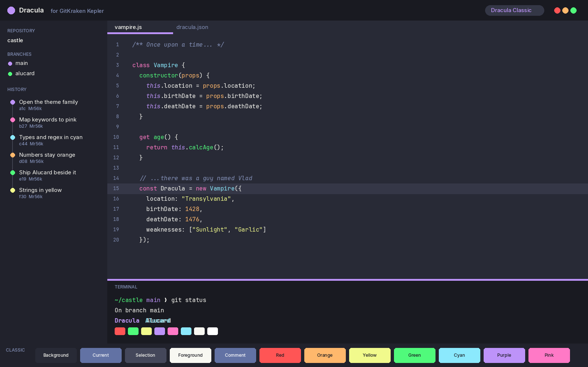
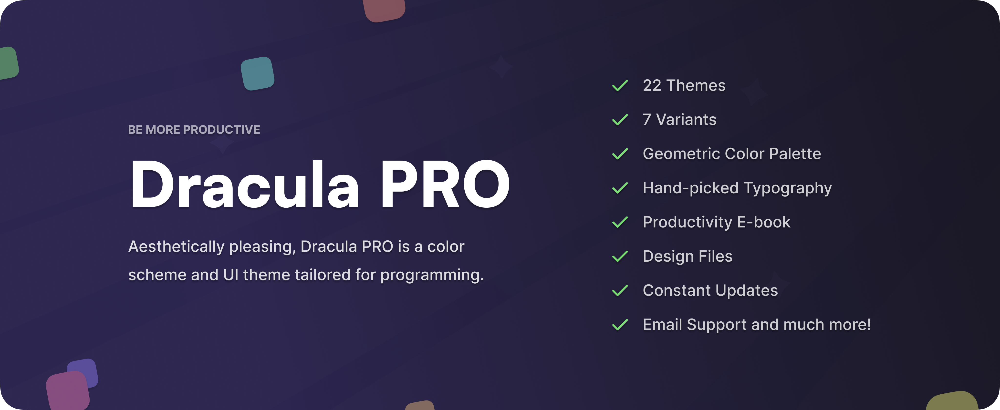

# Dracula for [GitKraken Kepler](https://www.gitkraken.com/)

> A dark and light theme for [GitKraken Kepler](https://www.gitkraken.com/).

Dracula Classic and Alucard Classic, packaged as one Kepler theme family (`schemaVersion` 2). This port follows the [Dracula specification](https://draculatheme.com/spec).

The classic GitKraken JSONC themes live in [dracula/gitkraken](https://github.com/dracula/gitkraken). Those files are for the original GitKraken theme format. This repository is only for Kepler.

## Install

All instructions can be found at [draculatheme.com/kepler](https://draculatheme.com/kepler).

That page is the placeholder until this repository is transferred to the Dracula organization. The steps in [INSTALL.md](./INSTALL.md) work from this repository today.

## Team

This theme is maintained by the following person(s) and a bunch of [awesome contributors](https://github.com/fits-ki/kepler/graphs/contributors).

|  |  |  |
| ----------------------------------------------------------------------------------- | ---------------------------------------------------------------------------------------- | --------------------------------------------------------------------------------------------- |
| [Tobias Feigel](https://github.com/Mr56k) | [Zeno Rocha](https://github.com/zenorocha) | [Lucas de França](https://github.com/luxonauta) |

Tobias Feigel maintains this Kepler port. Zeno Rocha and Lucas de França are the core Dracula Theme team.

## Community

Join thousands of vampires using Dracula Theme around the world 🦇

- [X (Twitter)](https://x.com/draculatheme) and [Instagram](https://www.instagram.com/draculatheme) - Follow for tips, news, and fun.
- [Discord](https://draculatheme.com/discord-invite) - Hang out and chat with the rest of the clan.
- [GitHub Discussions](https://github.com/dracula/dracula-theme/discussions) - Ask questions and discuss issues.

## Dracula PRO

## License

[MIT License](./LICENSE)
